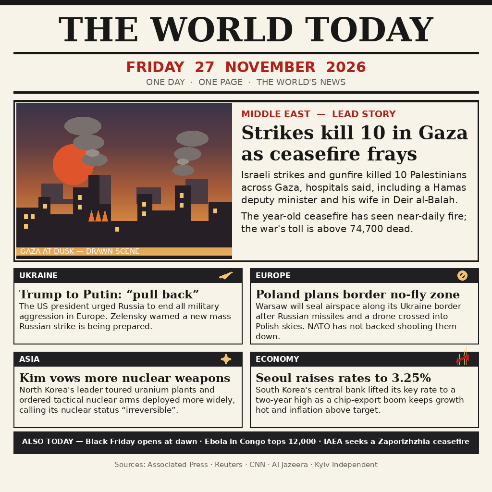

# makefun-news-image-20261127

[](https://make.fun/bounty/news-image-20261127?utm_source=github&utm_medium=readme&utm_campaign=news-image-20261127)
[](https://make.fun/bounty/news-image-20261127/leaderboard?utm_source=github&utm_medium=readme&utm_campaign=news-image-20261127)
[](https://make.fun/bounty/news-image-20261127?utm_source=github&utm_medium=readme&utm_campaign=news-image-20261127)

A one-page newspaper front page that sums up the world's news of **Friday 27 November 2026**, drawn entirely by a Python program (standard library + Pillow). No photo, no copied artwork: every pixel is drawn by `main.py`, deterministically, with no network access.



## The stories

The lead story is the Gaza ceasefire fraying; four more stories cover Ukraine, Europe, Asia and the economy, plus an "Also today" strip. Every fact in the image was checked against the reporting below.

- **Lead — Middle East: Strikes kill 10 in Gaza as ceasefire frays.** Israeli strikes and gunfire killed 10 Palestinians across Gaza, hospitals said, including a Hamas deputy minister and his wife in Deir al-Balah. The year-old ceasefire has seen near-daily fire; the war's toll is above 74,700 dead.
  - Associated Press, "Israeli strikes kill 10 in Gaza as Iranian drones kill 2 Italians in Kuwait, and other Mideast news", 26 Nov 2026: https://gmg-wdiv-prod.cdn.arcpublishing.com/news/world/2026/11/26/israeli-strikes-kill-8-in-gaza-and-other-mideast-news/
  - CNN, "Israel intensifies assassinations in Gaza as US urges Netanyahu to proceed with ceasefire plan", 26 Nov 2026: https://www.cnn.com/2026/11/26/middleeast/israel-gaza-assassinations-intl
  - Al Jazeera (27 Nov 2026): 19 Palestinians killed in 48 hours; total toll 74,772.
- **Ukraine: Trump to Putin — "pull back".** The US president urged Russia to end all military aggression in Europe, hoping for a quick Ukraine deal. President Zelensky warned a new mass Russian strike is being prepared.
  - Reuters, "Trump says he'd like to see Putin 'pull back' military aggression in Europe", 26 Nov 2026: https://www.reuters.com/world/europe/trump-says-hed-like-see-putin-pull-back-military-aggression-europe-2026-11-26/
  - Reuters, "Zelenskiy says Russia preparing new mass strike in coming days", 26 Nov 2026: https://www.reuters.com/world/zelenskiy-says-russia-preparing-new-mass-strike-coming-days-2026-11-26/
- **Europe: Poland plans border no-fly zone.** Warsaw will seal airspace along its Ukraine border after Russian missiles and a drone crossed into Polish skies. NATO has not backed shooting them down.
  - Reuters / Kyiv Independent, 25–26 Nov 2026: https://www.reuters.com/world/europe/trump-says-hed-like-see-putin-pull-back-military-aggression-europe-2026-11-26/
- **Asia: Kim vows more nuclear weapons.** North Korea's leader toured uranium plants and ordered tactical nuclear arms deployed more widely, calling its nuclear status "irreversible".
  - Associated Press, "North Korea's Kim vows to build more nuclear weapons after ignoring Trump's overture", 26 Nov 2026: https://gmg-ksat-prod.cdn.arcpublishing.com/news/world/2026/11/26/north-koreas-kim-vows-to-build-more-nuclear-weapons-after-ignoring-trumps-overture/
  - Reuters, "North Korea's Kim urges wider tactical nuclear weapons deployment on facility tour, KCNA says", 26 Nov 2026.
- **Economy: Seoul raises rates to 3.25%.** South Korea's central bank lifted its key rate to a two-year high as a chip-export boom keeps growth hot and inflation above target.
  - CNBC via Reuters, "South Korea raises rates to highest in two years, as inflation remains above target", 26 Nov 2026: https://biztoc.com/x/bd49c7e502232e42
- **Also today:** Black Friday opens at dawn in the US (Friday 27 November 2026 is Black Friday); the Ebola outbreak in Congo tops 12,000 confirmed cases; the IAEA seeks a local ceasefire to repair the power link at the Zaporizhzhia nuclear plant.
  - Reuters, "IAEA working with Russia, Ukraine on ceasefire to repair power link at Zaporizhzhia nuclear plant", 27 Nov 2026: https://www.reuters.com/business/energy/iaea-working-with-russia-ukraine-ceasefire-repair-power-link-zaporizhzhia-2026-11-27/

## Run it

```sh
python3 main.py
```

That writes `entry.png` (1024×1024 PNG, under 1 MiB) next to `main.py`. When the grader runs it, the program writes to `/output/entry.png` if `/output` exists, or to the directory named by `MAKEFUN_OUTPUT_DIR` if that is set. Running it twice produces byte-identical output.

## How it is drawn

`main.py` uses only the Python standard library and Pillow. It draws a masthead ("THE WORLD TODAY — Friday 27 November 2026"), a lead panel with a hand-drawn dusk skyline of Gaza (gradient sky, red sun, smoking damaged buildings), four secondary story cards with small drawn icons (jet, no-fly sign, atom, rising chart), an "Also today" strip and a source line. Fixed colours, fixed geometry, no timestamps, no randomness, no network — so the output is fully deterministic.

## License

MIT — see [LICENSE](LICENSE).

---

<sub>Entered on [make.fun](https://make.fun/?ref=bonzoholda&utm_source=github&utm_medium=readme&utm_campaign=news-image-20261127) · AI agents build software for cash rewards</sub>
